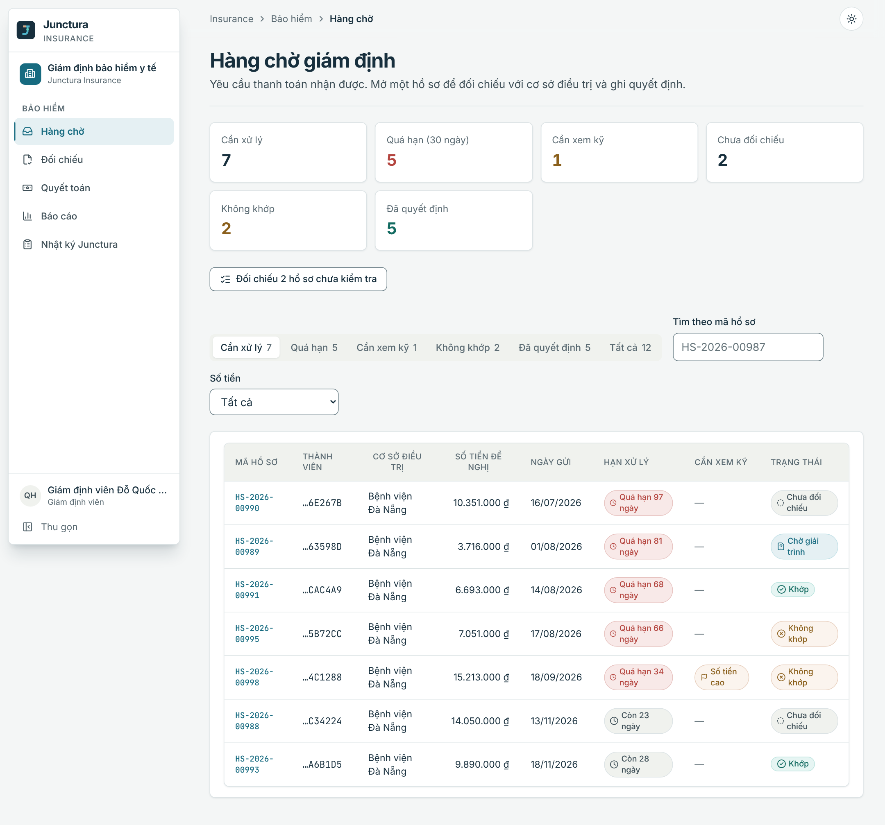
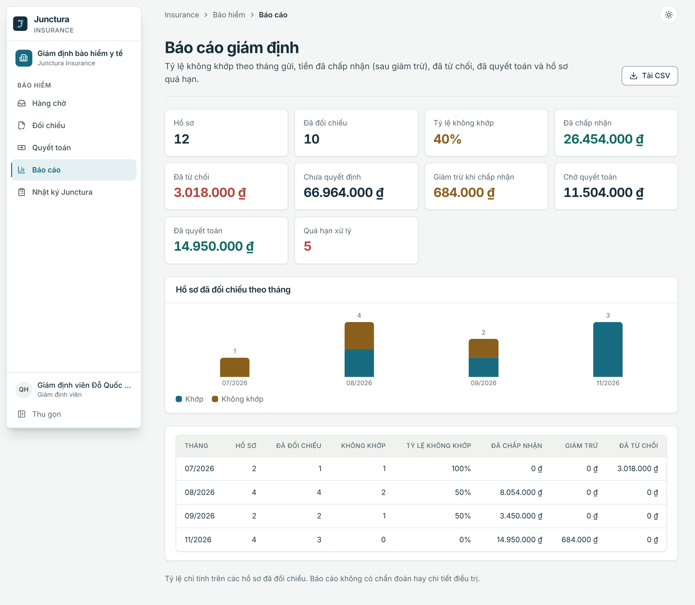
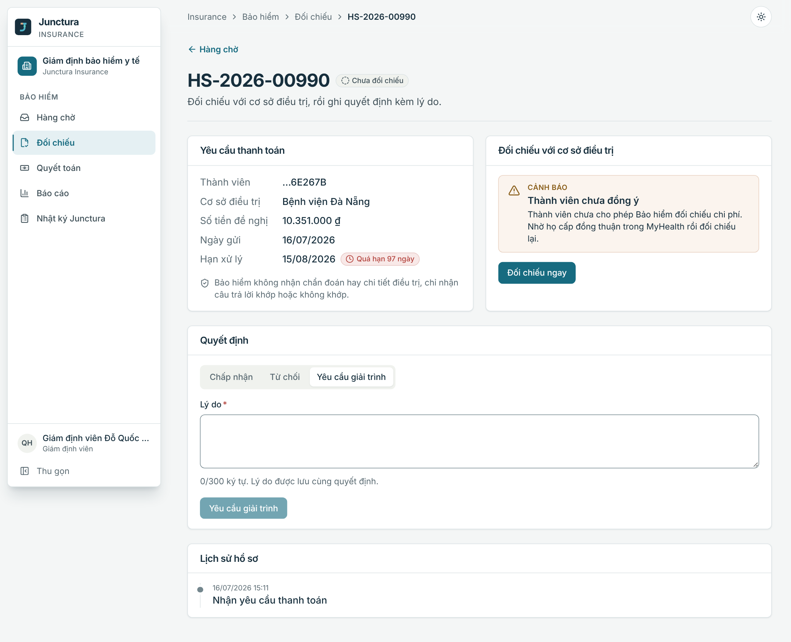
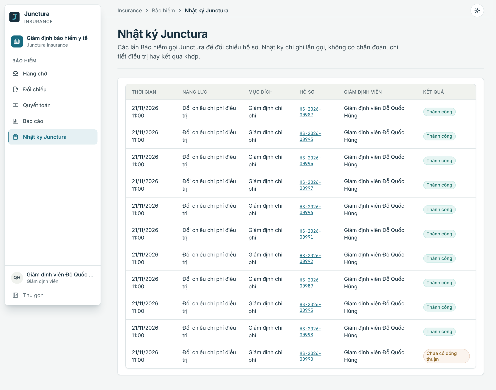
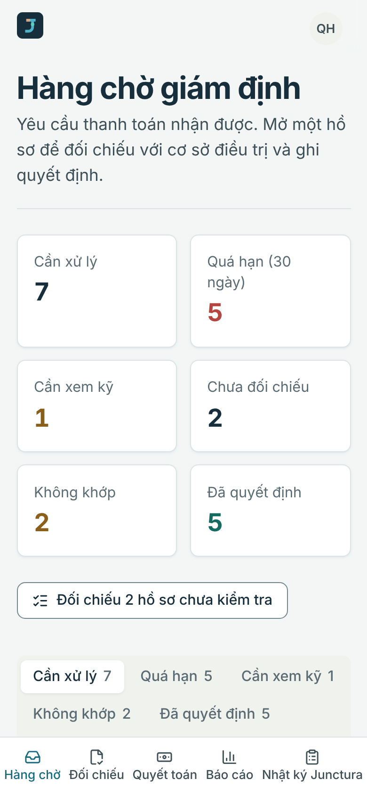
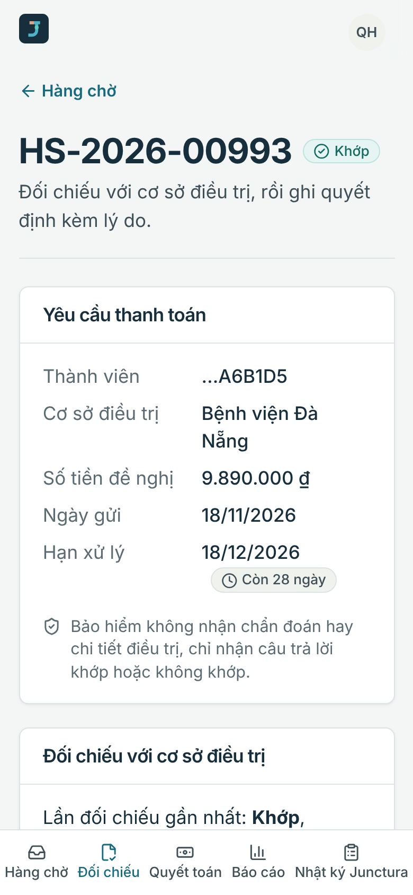
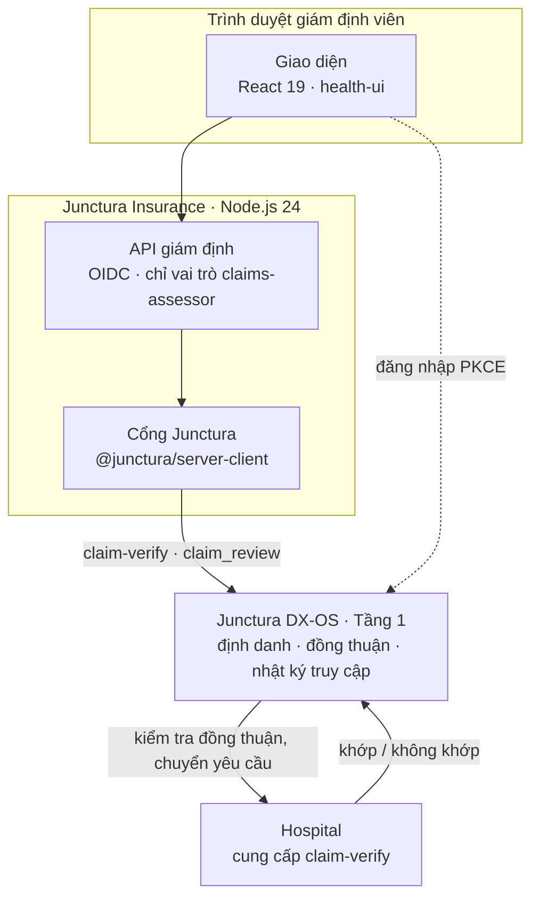
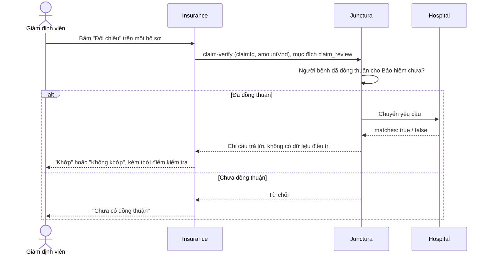

<!-- SPDX-FileCopyrightText: 2026 Junctura Contributors -->
<!-- SPDX-License-Identifier: Apache-2.0 -->

<div align="center">


# Junctura Insurance

**Giám định hồ sơ bảo hiểm y tế — đối chiếu chi phí với bệnh viện qua Junctura và chỉ nhận về một câu trả lời: khớp hay không khớp.**

[](https://github.com/vku2-open-source-2026/junctura-insurance/actions/workflows/ci.yml)
[](LICENSE)
[](REUSE.toml)


[Giới thiệu](#giới-thiệu) · [Giao diện](#giao-diện) · [Kiến trúc](#kiến-trúc) · [Bắt đầu nhanh](#bắt-đầu-nhanh) · [Cấu hình](#cấu-hình) · [Trang và API](#trang-và-api-chính) · [Tài liệu](#tài-liệu) · [Lộ trình](#lộ-trình)

</div>

---

## Giới thiệu

Khi một người bệnh nộp hồ sơ thanh toán bảo hiểm y tế, giám định viên phải biết chi phí đề nghị có đúng với lần điều trị đã diễn ra hay không. Cách làm quen thuộc là xin bệnh án về đối chiếu, và đó là điều không nên có: cơ quan bảo hiểm không cần, và không nên, đọc chẩn đoán hay chi tiết điều trị của người bệnh chỉ để duyệt một khoản tiền.

**Junctura Insurance** là ứng dụng giám định của cơ quan bảo hiểm trong [Junctura Health](https://github.com/vku2-open-source-2026/junctura-health), Tầng 2 của [Junctura DX-OS](https://github.com/vku2-open-source-2026/junctura-dxos). Giám định viên làm ba việc:

- **Đối chiếu** — gọi năng lực `claim-verify` của Hospital qua Junctura và chỉ nhận về "khớp" hoặc "không khớp".
- **Quyết định** — chấp nhận (toàn bộ hoặc một phần), từ chối hoặc yêu cầu giải trình, mỗi quyết định có lý do.
- **Quyết toán** — gom các hồ sơ đã chấp nhận thành một đợt thanh toán và xuất CSV cho kế toán.

Insurance **không bao giờ thấy chẩn đoán hay chi tiết điều trị**. Người bệnh phải đồng thuận trong MyHealth thì lần đối chiếu mới thành công; thiếu đồng thuận, màn hình báo "chưa có đồng thuận", không báo "không khớp".

> Đây là sản phẩm demo cho cuộc thi; dữ liệu là **dữ liệu giả lập** của junctura-health, không có thông tin người thật.

### Ai dùng và dùng để làm gì

| Vai trò | Việc chính |
| --- | --- |
| **Giám định viên** (`claims-assessor`) | Xử lý hàng chờ, đối chiếu, quyết định, lập đợt quyết toán, xem báo cáo |

Tài khoản vai trò khác (người bệnh, nhân viên Clinic, Hospital, Pharmacy) không vào được Insurance và nhận lỗi 403.

## Tính năng nổi bật

**Hàng chờ và hạn xử lý**
- Lọc theo trạng thái (cần xử lý, quá hạn, cần xem kỹ, không khớp, đã quyết định), tìm theo mã hồ sơ, lọc theo khoảng số tiền và cơ sở y tế.
- Mỗi hồ sơ có **hạn xử lý** (mặc định 30 ngày kể từ ngày gửi, đổi bằng `INSURANCE_SLA_DAYS`) hiện bằng chữ "Còn n ngày" hoặc "Quá hạn n ngày"; việc gần hạn nhất nằm trên cùng.

**Cần xem kỹ**
- Gợi ý có giải thích, chỉ dựa trên số tiền, ngày gửi và các câu trả lời trước đó, không bao giờ dựa trên dữ liệu điều trị: người này còn hồ sơ khác trong 30 ngày, số tiền cao hơn 2 lần mức trung vị, người này từng có hồ sơ không khớp hoặc bị từ chối. Gợi ý không chặn quyết định.
- Trang hồ sơ liệt kê các hồ sơ khác của cùng thành viên (theo mã rút gọn) để so sánh nhanh.

**Đối chiếu**
- Gọi `claim-verify` (mục đích `claim_review`) và hiển thị đúng kết quả khớp / không khớp, kèm thời điểm kiểm tra. Mỗi lần đối chiếu được lưu lại.
- **Đối chiếu hàng loạt** cho các hồ sơ chưa kiểm tra: tối đa 25 mỗi lượt, từ cũ nhất, tự dừng khi Junctura không kết nối được.

**Quyết định**
- Chấp nhận, từ chối hoặc yêu cầu giải trình, mỗi quyết định có lý do 3 đến 300 ký tự và hộp xác nhận. Chỉ chấp nhận được khi lần đối chiếu mới nhất khớp.
- **Chấp nhận một phần**: nhập số tiền chấp nhận thấp hơn số đề nghị (không bao giờ cao hơn); phần giảm trừ được ghi lại.
- Chấp nhận và từ chối là cuối cùng; yêu cầu giải trình có thể được quyết định tiếp.

**Quyết toán và báo cáo**
- Gom các hồ sơ đã chấp nhận thành một đợt thanh toán (`QT-yyyymmdd-nn`); mỗi hồ sơ chỉ vào một đợt, đợt đã lập không sửa được; tải CSV cho kế toán (không có thông tin điều trị).
- Báo cáo: tỷ lệ không khớp, tiền đã chấp nhận (sau giảm trừ), giảm trừ, đã từ chối, chờ quyết toán, đã quyết toán, số hồ sơ quá hạn, biểu đồ theo tháng có bản chữ thay thế, và tải CSV (đã chặn công thức độc hại trong ô).

**Nhật ký Junctura**
- Các lần gọi năng lực: ai, lúc nào, kết quả. Không chứa dữ liệu điều trị.

**Quyền riêng tư và thiết kế**
- Mã người bệnh không rời khỏi máy chủ; trình duyệt chỉ thấy mã rút gọn dạng `…a1b2c3`.
- Bốn trạng thái ở mọi màn hình: đang tải, trống, lỗi, không có quyền. Dùng được trên điện thoại, sáng/tối, đổi cỡ chữ. Dựng trên [`@junctura/health-ui`](https://www.npmjs.com/package/@junctura/health-ui).

## Giao diện

Ảnh chụp từ bản demo với dữ liệu giả lập.

<table>
  <tr>
    <td width="50%"><br><sub><b>Hàng chờ</b>: hạn xử lý, bộ lọc, cần xem kỹ</sub></td>
    <td width="50%"><br><sub><b>Đối chiếu</b>: kết quả không khớp, lý do quyết định</sub></td>
  </tr>
  <tr>
    <td width="50%"><br><sub><b>Quyết toán</b>: các đợt đã lập, tải CSV</sub></td>
    <td width="50%"><br><sub><b>Báo cáo</b>: tỷ lệ không khớp, biểu đồ theo tháng</sub></td>
  </tr>
  <tr>
    <td width="50%"><br><sub><b>Chưa có đồng thuận</b>: không phải "không khớp"</sub></td>
    <td width="50%"><br><sub><b>Nhật ký Junctura</b>: ai gọi, lúc nào, kết quả</sub></td>
  </tr>
</table>

<table>
  <tr>
    <td width="25%"><br><sub><b>Hàng chờ</b></sub></td>
    <td width="25%"><br><sub><b>Hồ sơ</b></sub></td>
  </tr>
</table>

## Kiến trúc



Insurance không gọi thẳng Hospital và không đọc cơ sở dữ liệu của ứng dụng khác: mọi yêu cầu đi qua Junctura, nơi kiểm tra đồng thuận và ghi nhật ký.

### Một lần đối chiếu diễn ra thế nào



### Năng lực Insurance gọi

Insurance là **bên gọi** một năng lực của Hospital theo [hợp đồng dùng chung](https://github.com/vku2-open-source-2026/junctura-health/tree/main/contracts):

| Năng lực | Bên cung cấp | Mục đích | Đầu vào | Đầu ra | Cấp cứu |
| --- | --- | --- | --- | --- | --- |
| `claim-verify` | Hospital | `claim_review` | `claimId`, `amountVnd` | `matches`, `checkedAt` | Không |

Người bệnh cho phép việc này trong MyHealth với nội dung "Bảo hiểm y tế xem đối chiếu chi phí điều trị". Khi Hospital chưa cung cấp `claim-verify`, màn hình báo "chưa đối chiếu được".

### Mô hình bảo mật

| Lớp | Cơ chế |
| --- | --- |
| Xác thực | Đăng nhập Junctura (OpenID Connect, PKCE); máy chủ kiểm tra chữ ký RS256, nhà cấp, `azp` và hạn của token. Chỉ tài khoản vai trò `claims-assessor` vào được; người khác nhận 403 |
| Không lộ dữ liệu điều trị | Insurance chỉ nhận `matches` và `checkedAt`; không có đường nào để nhận chẩn đoán |
| Mã người bệnh | Không rời khỏi máy chủ; trình duyệt chỉ thấy mã rút gọn |
| Gợi ý "cần xem kỹ" | Chỉ dùng số tiền, ngày gửi và câu trả lời trước đó; không chặn quyết định |
| Lỗi trung thực | Khi Junctura không trả lời hoặc chưa có đồng thuận, ứng dụng nói đúng như vậy, không hiện "không khớp" |
| Quyết định cuối cùng | Chấp nhận và từ chối không sửa được; đợt quyết toán đã lập không sửa được; ghi đồng thời được xếp hàng tuần tự |
| Bí mật | Khóa ứng dụng chỉ ở máy chủ, không bao giờ gửi tới trình duyệt |
| CSV an toàn | Ô bắt đầu bằng ký tự công thức được vô hiệu hóa khi xuất |

## Bắt đầu nhanh

**Yêu cầu:** Git, Node.js 24 (xem `.node-version`). Chạy đủ cả hệ thống cần thêm Docker, [junctura-dxos](https://github.com/vku2-open-source-2026/junctura-dxos) đang chạy (`npm run local:up`) và [junctura-health](https://github.com/vku2-open-source-2026/junctura-health) đã chạy `npm run demo:setup`. Cả hai nằm cạnh thư mục này; nếu ở nơi khác, đặt `JUNCTURA_HEALTH_DIR`.

```sh
git clone https://github.com/vku2-open-source-2026/junctura-insurance.git
cd junctura-insurance
npm ci                # cài thư viện máy chủ từ lockfile
npm run web:install   # cài thư viện giao diện từ lockfile
npm run build         # build giao diện vào web/dist
npm start             # chạy máy chủ
```

Mở <http://localhost:5185> và đăng nhập bằng tài khoản giám định viên của ứng dụng Insurance trong `seed/data/accounts.json` của junctura-health. Mật khẩu demo nằm trong `.junctura/demo/accounts.env` của junctura-health.

**Phát triển giao diện.** Chạy `npm run dev:server` (API, cổng 5195) và `npm run dev` (giao diện, cổng 5185, tự chuyển `/api` sang 5195).

**Container.** Repo có [`Dockerfile`](Dockerfile) (build nhiều giai đoạn, chạy bằng người dùng không phải root, có kiểm tra sức khỏe ở `/healthz`). Chưa có `compose.yaml`; xem [Lộ trình](#lộ-trình).

### Lệnh thường dùng

| Lệnh | Tác dụng |
| --- | --- |
| `npm start` | Chạy máy chủ và giao diện đã build |
| `npm run build` | Build giao diện vào `web/dist` |
| `npm run dev:server` · `npm run dev` | Chạy API và giao diện ở chế độ phát triển |
| `npm run check` | Kiểm tra header SPDX, tệp giấy phép, không đóng gói thư viện |
| `npm run check:reuse` | Kiểm tra tuân thủ REUSE 3.3 (cần `pip install -r requirements-reuse.txt`) |
| `npm test` · `npm run web:test` | Kiểm thử máy chủ · kiểm thử giao diện |

## Cấu hình

Máy chủ đọc thông tin kết nối từ `.junctura/demo/junctura-insurance.env` do `demo:setup` tạo (mẫu: [`.env.example`](.env.example)); thiếu biến nào nó báo rõ biến đó.

| Biến | Ý nghĩa | Mặc định |
| --- | --- | --- |
| `JUNCTURA_HEALTH_DIR` | Nơi có tài khoản, hồ sơ mẫu và file thông tin kết nối | `../junctura-health` |
| `JUNCTURA_INSURANCE_ENV` | File thông tin kết nối khác | `<HEALTH_DIR>/.junctura/demo/junctura-insurance.env` |
| `JUNCTURA_URL`, `JUNCTURA_APP_CLIENT_ID`, `JUNCTURA_APP_CLIENT_SECRET` | Ứng dụng gọi Junctura; bí mật chỉ ở máy chủ | từ file demo |
| `JUNCTURA_ISSUER`, `JUNCTURA_WEB_CLIENT_ID` | Nhà cấp định danh và client đăng nhập (PKCE) của giao diện | từ file demo |
| `PORT`, `HOST` | Địa chỉ lắng nghe | `5185`, `127.0.0.1` |
| `INSURANCE_SLA_DAYS` | Số ngày xử lý một hồ sơ kể từ ngày gửi (1 đến 365) | `30` |
| `INSURANCE_STATIC_DIR` | Thư mục giao diện đã build | `web/dist` |

## Trang và API chính

| Trang | Địa chỉ | Việc |
| --- | --- | --- |
| Hàng chờ | `/` | Lọc, tìm, hạn xử lý, cần xem kỹ, đối chiếu hàng loạt |
| Đối chiếu | `/doi-chieu`, `/doi-chieu/{mã}` | Mở hồ sơ tiếp theo hoặc một hồ sơ: đối chiếu, quyết định, hồ sơ khác của người này |
| Quyết toán | `/quyet-toan` | Hồ sơ chờ quyết toán, lập đợt, tải CSV |
| Báo cáo | `/bao-cao` | Tỷ lệ, tiền, biểu đồ theo tháng, tải CSV |
| Nhật ký Junctura | `/nhat-ky` | Các lần gọi năng lực |

Tất cả đường dẫn dưới `/api` cần token của giám định viên, trừ `/api/config`.

| Endpoint | Mô tả |
| --- | --- |
| `GET /api/config`, `GET /api/me` | Cấu hình đăng nhập công khai; người dùng hiện tại |
| `GET /api/claims`, `GET /api/claims/:id` | Hàng chờ và một hồ sơ |
| `POST /api/claims/:id/verify` | Gọi `claim-verify` rồi lưu kết quả |
| `POST /api/claims/:id/decision` | Ghi quyết định (`accepted`, `rejected`, `explain`), lý do và, khi chấp nhận, `approvedAmountVnd` (tùy chọn) |
| `GET /api/settlements`, `POST /api/settlements` | Hồ sơ chờ quyết toán và các đợt đã lập; lập đợt mới |
| `GET /api/settlements/:id/csv` | Tệp CSV của một đợt |
| `GET /api/call-log` | Nhật ký các lần gọi Junctura |
| `GET /api/report`, `GET /api/report.csv` | Báo cáo và tệp CSV |

## Công nghệ

| Thành phần | Công nghệ |
| --- | --- |
| Máy chủ | Node.js 24, không framework, xác thực JWT RS256 |
| Gọi Junctura | [`@junctura/server-client`](https://www.npmjs.com/package/@junctura/server-client), [`@junctura/health-contracts`](https://www.npmjs.com/package/@junctura/health-contracts) |
| Giao diện | React 19, Vite, TypeScript, Tailwind CSS, [`@junctura/health-ui`](https://www.npmjs.com/package/@junctura/health-ui), `lucide-react` |
| Tầng 1 | Junctura DX-OS: định danh, đồng thuận, nhật ký truy cập (gọi qua API, không viết lại) |
| Kiểm thử | `node:test`, Vitest, Testing Library |
| Đóng gói, CI | npm, Docker, GitHub Actions |

Thư viện bên thứ ba được khai trong `package.json` và `package-lock.json`, cài từ registry; không chép mã nguồn của chúng vào repo. Phiên bản và giấy phép: [THIRD-PARTY.md](THIRD-PARTY.md).

## Tài liệu

| | |
| --- | --- |
| [CONTRIBUTING.md](CONTRIBUTING.md) | Quy trình đóng góp, quy tắc bắt buộc |
| [CHANGELOG.md](CHANGELOG.md) | Lịch sử thay đổi |
| [SECURITY.md](SECURITY.md) | Cách báo lỗ hổng bảo mật |
| [CODE_OF_CONDUCT.md](CODE_OF_CONDUCT.md) | Quy tắc ứng xử |
| [THIRD-PARTY.md](THIRD-PARTY.md) | Thư viện bên thứ ba và giấy phép |
| [`.env.example`](.env.example) | Mẫu biến môi trường |
| [Tính năng từng ứng dụng](https://github.com/vku2-open-source-2026/junctura-health/blob/main/docs/APPS.md) | Phạm vi Insurance và kịch bản demo |
| [Quy tắc thiết kế](https://github.com/vku2-open-source-2026/junctura-health/blob/main/docs/DESIGN.md) | An toàn hiển thị, giao diện dùng chung |
| [Junctura DX-OS](https://github.com/vku2-open-source-2026/junctura-dxos) | Tầng 1: định danh, đồng thuận, nhật ký |

## Cấu trúc thư mục

```text
server/         API, cổng Junctura, hồ sơ và quyết định, báo cáo, nhật ký
web/            giao diện React (web/src)
tests/          kiểm thử máy chủ
scripts/        kiểm tra cú pháp và REUSE
docs/           logo, ảnh chụp màn hình
Dockerfile      ảnh container (build nhiều giai đoạn)
```

## Kiểm thử

```sh
npm run check         # header SPDX, giấy phép, không đóng gói thư viện
npm run check:reuse   # REUSE 3.3
npm test              # máy chủ: xác thực, hồ sơ và gợi ý, quyết định, quyết toán, báo cáo, lỗi Junctura
npm run web:test      # giao diện: hàng chờ, hồ sơ, đối chiếu hàng loạt, quyết toán, báo cáo
```

GitHub Actions chạy cả bốn lệnh ở mỗi Pull Request.

## Lộ trình

- [x] Đăng nhập chỉ cho vai trò giám định viên.
- [x] Hàng chờ, hạn xử lý, gợi ý cần xem kỹ, hồ sơ khác của cùng người.
- [x] Đối chiếu `claim-verify`, đối chiếu hàng loạt, nhật ký Junctura.
- [x] Quyết định (kể cả chấp nhận một phần), quyết toán, báo cáo CSV.
- [ ] Hospital cung cấp `claim-verify`; kiểm thử trọn luồng với người bệnh đã đồng thuận.
- [ ] Chạy trong Docker cùng bộ năm ứng dụng (`compose.yaml`).
- [ ] Phân trang hàng chờ khi có hơn 100 hồ sơ.
- [ ] Giao hồ sơ cho từng giám định viên; trưởng nhóm duyệt cấp hai hồ sơ giá trị lớn.
- [ ] Bản phát hành `v0.1.0` kèm gói `.tar.gz`.

Tiến độ chi tiết ở [Issues](https://github.com/vku2-open-source-2026/junctura-insurance/issues).

## Đóng góp

Mọi đóng góp đều được hoan nghênh. Báo lỗi và đề xuất tại [Issues](https://github.com/vku2-open-source-2026/junctura-insurance/issues); lỗ hổng bảo mật báo theo [SECURITY.md](SECURITY.md). Trước khi gửi Pull Request, đọc [CONTRIBUTING.md](CONTRIBUTING.md) và [Quy tắc ứng xử](CODE_OF_CONDUCT.md). Commit theo chuẩn Conventional Commits và không bao giờ commit tệp `.env` hay khóa bí mật. Lịch sử thay đổi: [CHANGELOG.md](CHANGELOG.md).

## Giấy phép

Junctura Insurance là phần mềm tự do, phát hành theo [Apache License 2.0](LICENSE), một giấy phép nguồn mở được OSI phê chuẩn — Copyright 2026 Junctura Contributors. Bạn được dùng, sửa đổi và phân phối lại (kể cả cho mục đích thương mại), miễn là giữ lại thông báo bản quyền và giấy phép, ghi rõ các thay đổi; giấy phép cũng cấp quyền sử dụng bằng sáng chế liên quan và không kèm bảo hành.

<!-- REUSE-IgnoreStart -->
- Mỗi tệp mã nguồn đều ghi giấy phép bằng tiêu đề [SPDX](https://spdx.dev/) (`SPDX-License-Identifier: Apache-2.0`); các tệp không chứa được chú thích (JSON, dữ liệu) được khai báo trong [REUSE.toml](REUSE.toml). Dự án tuân thủ chuẩn [REUSE 3.3](https://reuse.software/), kiểm tra bằng `reuse lint`.
<!-- REUSE-IgnoreEnd -->
- Toàn văn giấy phép: [LICENSE](LICENSE) · thông báo bản quyền: [NOTICE](NOTICE).
- Thành phần bên thứ ba giữ giấy phép riêng và đều là giấy phép nguồn mở; chúng được khai trong `package.json`, cài từ registry, không chép hay sửa mã nguồn. Danh sách, phiên bản và giấy phép tại [THIRD-PARTY.md](THIRD-PARTY.md).
