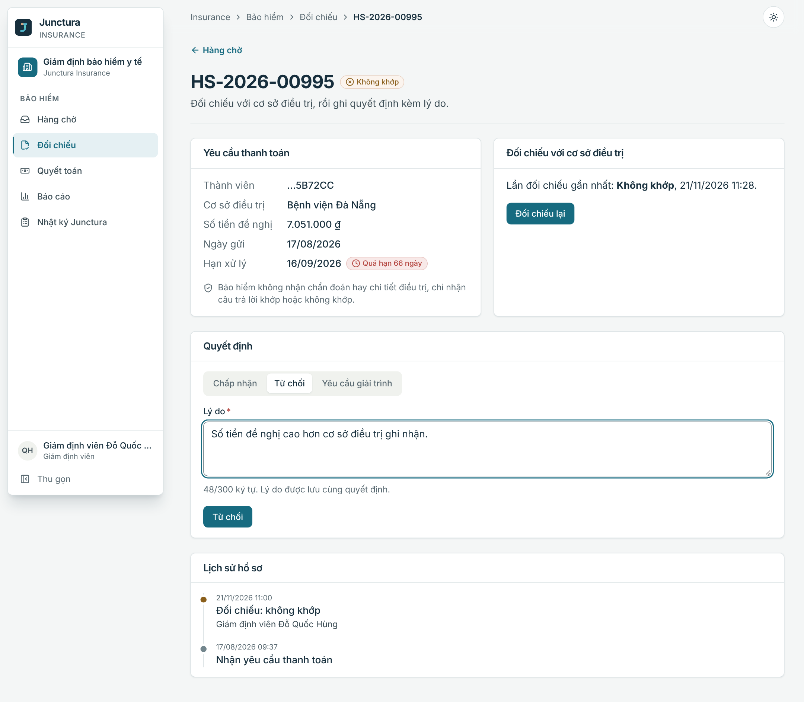
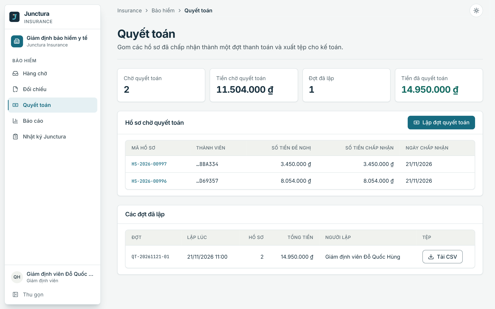
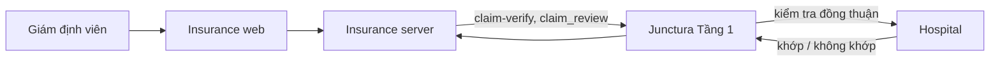

<!-- SPDX-FileCopyrightText: 2026 Junctura Contributors -->
<!-- SPDX-License-Identifier: Apache-2.0 -->

# Junctura Insurance

[](https://github.com/vku2-open-source-2026/junctura-insurance/actions/workflows/ci.yml)
[](LICENSE)
[](REUSE.toml)

**Junctura Insurance** là ứng dụng **giám định bảo hiểm y tế** trong [Junctura Health](https://github.com/vku2-open-source-2026/junctura-health), Tầng 2 của [Junctura DX-OS](https://github.com/vku2-open-source-2026/junctura-dxos). Giám định viên đối chiếu hồ sơ thanh toán với dữ liệu điều trị của bệnh viện qua Junctura và chỉ nhận về một câu trả lời: **khớp hay không khớp**. Ứng dụng không bao giờ thấy chẩn đoán hay chi tiết điều trị.

> Trạng thái: đang xây dựng. Theo dõi tiến độ ở [Issues](https://github.com/vku2-open-source-2026/junctura-insurance/issues) và [CHANGELOG](CHANGELOG.md).

## Ảnh chụp màn hình

| Hàng chờ | Đối chiếu (không khớp) |
| --- | --- |
|  |  |
| **Quyết toán** | **Báo cáo** |
|  |  |

## Vai trò trong hệ thống

Insurance là **bên gọi** một năng lực của Hospital theo [hợp đồng dùng chung](https://github.com/vku2-open-source-2026/junctura-health/tree/main/contracts):

| Năng lực | Bên cung cấp | Mục đích | Đầu vào | Đầu ra | Cấp cứu |
| --- | --- | --- | --- | --- | --- |
| `claim-verify` | Hospital | `claim_review` | `claimId`, `amountVnd` | `matches`, `checkedAt` | Không |



Insurance không gọi thẳng Hospital và không đọc database của ứng dụng khác. Người bệnh phải **đồng thuận** trong MyHealth ("Bảo hiểm y tế xem đối chiếu chi phí điều trị") thì lần đối chiếu mới thành công; thiếu đồng thuận thì màn hình báo "chưa có đồng thuận", không phải "không khớp".

## Hiện có

- **Đăng nhập bằng Junctura** (OpenID Connect, PKCE): chỉ giám định viên (`claims-assessor`) dùng được; người khác nhận 403.
- **Hàng chờ**: lọc theo trạng thái (cần xử lý, quá hạn, cần xem kỹ, không khớp, đã quyết định), tìm theo mã hồ sơ, lọc theo khoảng số tiền và cơ sở y tế. Mỗi hồ sơ có **hạn xử lý** (mặc định 30 ngày kể từ ngày gửi, đổi bằng `INSURANCE_SLA_DAYS`) hiện bằng chữ "Còn n ngày" hoặc "Quá hạn n ngày"; việc gần hạn nhất nằm trên cùng.
- **Cần xem kỹ**: gợi ý có giải thích, chỉ dựa trên số tiền, ngày gửi và các câu trả lời trước đó, không bao giờ dựa trên dữ liệu điều trị: người này còn hồ sơ khác trong 30 ngày, số tiền cao hơn 2 lần mức trung vị, người này từng có hồ sơ không khớp hoặc bị từ chối. Gợi ý không chặn quyết định.
- **Hồ sơ khác của người này**: trang hồ sơ liệt kê các hồ sơ còn lại của cùng thành viên (theo mã rút gọn) để so sánh nhanh.
- **Đối chiếu**: gọi `claim-verify` và hiển thị đúng kết quả khớp / không khớp, kèm thời điểm kiểm tra. Mỗi lần đối chiếu được lưu lại. **Đối chiếu hàng loạt** cho các hồ sơ chưa kiểm tra (tối đa 25 mỗi lượt, từ cũ nhất, tự dừng khi Junctura không kết nối được).
- **Quyết định**: chấp nhận, từ chối hoặc yêu cầu giải trình, mỗi quyết định có lý do 3 đến 300 ký tự và hộp xác nhận. Chỉ chấp nhận được khi lần đối chiếu mới nhất khớp. **Chấp nhận một phần**: nhập số tiền chấp nhận thấp hơn số đề nghị (không bao giờ cao hơn), phần giảm trừ được ghi lại. Chấp nhận và từ chối là cuối cùng; yêu cầu giải trình có thể được quyết định tiếp.
- **Quyết toán**: gom các hồ sơ đã chấp nhận thành một đợt thanh toán (`QT-yyyymmdd-nn`), mỗi hồ sơ chỉ vào một đợt, đợt đã lập không sửa được; tải CSV cho kế toán (không có thông tin điều trị).
- **Báo cáo**: tỷ lệ không khớp, tiền đã chấp nhận (sau giảm trừ), giảm trừ, đã từ chối, chờ quyết toán, đã quyết toán, số hồ sơ quá hạn, biểu đồ theo tháng và tải CSV (đã chặn công thức độc hại trong ô).
- **Nhật ký Junctura**: các lần gọi năng lực (ai, lúc nào, kết quả), không chứa dữ liệu điều trị.
- **Quyền riêng tư**: mã người bệnh không rời khỏi máy chủ; trình duyệt chỉ thấy mã rút gọn dạng `…a1b2c3`.
- **Bốn trạng thái ở mọi màn hình**: đang tải, trống, lỗi, không có quyền. Dùng được trên điện thoại, sáng/tối, cỡ chữ.
- Dữ liệu là **dữ liệu giả lập** của [junctura-health](https://github.com/vku2-open-source-2026/junctura-health), đọc trực tiếp từ thư mục đó (không chép vào repo).

Chưa có: Hospital cung cấp `claim-verify` (do nhóm Hospital làm); khi chưa có, màn hình báo "chưa đối chiếu được". Xem [Issues](https://github.com/vku2-open-source-2026/junctura-insurance/issues).

## Yêu cầu

- Node.js 24 (xem `.node-version`).
- [junctura-dxos](https://github.com/vku2-open-source-2026/junctura-dxos) đang chạy và [junctura-health](https://github.com/vku2-open-source-2026/junctura-health) đã chạy `npm run demo:setup`. Cả hai nằm cạnh thư mục này; nếu ở nơi khác, đặt `JUNCTURA_HEALTH_DIR`.

## Build từ mã nguồn

```sh
git clone https://github.com/vku2-open-source-2026/junctura-insurance.git
cd junctura-insurance
npm ci
npm run check
npm run check:reuse     # cần `pip install -r requirements-reuse.txt`
npm test                # kiểm thử máy chủ
npm run web:install     # cài thư viện giao diện từ lockfile
npm run web:test        # kiểm thử giao diện
npm run build           # build giao diện vào web/dist
```

## Chạy

```sh
npm start
```

Mở <http://localhost:5185> và đăng nhập bằng tài khoản giám định viên của ứng dụng Insurance trong `seed/data/accounts.json` của junctura-health. Mật khẩu demo nằm trong `.junctura/demo/accounts.env` của junctura-health. Máy chủ đọc thông tin kết nối từ `.junctura/demo/junctura-insurance.env` do `demo:setup` tạo (xem [`.env.example`](.env.example)); thiếu biến nào thì máy chủ báo rõ.

Khi sửa giao diện, chạy hai tiến trình: `npm run dev:server` (API ở cổng 5195) và `npm run dev` (giao diện ở cổng 5185, tự chuyển `/api` sang cổng 5195).

### Cấu hình

| Biến | Mặc định | Ý nghĩa |
| --- | --- | --- |
| `JUNCTURA_HEALTH_DIR` | `../junctura-health` | Nơi có tài khoản, hồ sơ mẫu và file thông tin kết nối |
| `JUNCTURA_INSURANCE_ENV` | `<HEALTH_DIR>/.junctura/demo/junctura-insurance.env` | File thông tin kết nối khác |
| `JUNCTURA_URL`, `JUNCTURA_APP_CLIENT_ID`, `JUNCTURA_APP_CLIENT_SECRET` | từ file trên | Ứng dụng gọi Junctura; bí mật chỉ ở máy chủ |
| `JUNCTURA_ISSUER`, `JUNCTURA_WEB_CLIENT_ID` | từ file trên | Đăng nhập trình duyệt (PKCE) |
| `PORT`, `HOST` | `5185`, `127.0.0.1` | Địa chỉ lắng nghe |
| `INSURANCE_SLA_DAYS` | `30` | Số ngày xử lý một hồ sơ kể từ ngày gửi (1 đến 365) |
| `INSURANCE_STATIC_DIR` | `web/dist` | Thư mục giao diện đã build |

## Giao diện lập trình (API)

Tất cả đường dẫn dưới `/api` cần token của giám định viên, trừ `/api/config`.

| Đường dẫn | Việc làm |
| --- | --- |
| `GET /api/config`, `GET /api/me` | Cấu hình đăng nhập công khai; người dùng hiện tại |
| `GET /api/claims`, `GET /api/claims/:id` | Hàng chờ và một hồ sơ |
| `POST /api/claims/:id/verify` | Gọi `claim-verify` rồi lưu kết quả |
| `POST /api/claims/:id/decision` | Ghi quyết định (`accepted`, `rejected`, `explain`), lý do và, khi chấp nhận, `approvedAmountVnd` (tùy chọn) |
| `GET /api/settlements`, `POST /api/settlements` | Hồ sơ chờ quyết toán và các đợt đã lập; lập đợt mới |
| `GET /api/settlements/:id/csv` | Tệp CSV của một đợt |
| `GET /api/call-log` | Nhật ký các lần gọi Junctura |
| `GET /api/report`, `GET /api/report.csv` | Báo cáo và tệp CSV |

## Công nghệ

| Phần | Dùng |
| --- | --- |
| Máy chủ | Node.js 24, không framework, xác thực JWT RS256 |
| Giao diện | React 19, Vite, TypeScript, Tailwind CSS, [`@junctura/health-ui`](https://www.npmjs.com/package/@junctura/health-ui), `lucide-react` |
| Gọi Junctura | [`@junctura/server-client`](https://www.npmjs.com/package/@junctura/server-client), [`@junctura/health-contracts`](https://www.npmjs.com/package/@junctura/health-contracts) |
| Kiểm thử | `node:test`, Vitest, Testing Library |

Danh sách thành phần bên thứ ba và giấy phép: [THIRD-PARTY.md](THIRD-PARTY.md).

## Hướng phát triển

- Hospital cung cấp `claim-verify`, kiểm thử trọn luồng với người bệnh đã đồng thuận.
- Phân trang hàng chờ khi kho bản ghi có hơn 100 dòng.
- Phân quyền chi tiết hơn (trưởng nhóm giám định duyệt cấp hai hồ sơ giá trị lớn).
- Giao hồ sơ cho từng giám định viên.

## Đóng góp

Xem [CONTRIBUTING.md](CONTRIBUTING.md). Báo lỗi và đề xuất ở [Issues](https://github.com/vku2-open-source-2026/junctura-insurance/issues); báo lỗ hổng theo [SECURITY.md](SECURITY.md).

## Giấy phép

Mã nguồn phát hành theo [Apache License 2.0](LICENSE); xem thêm [NOTICE](NOTICE). Mỗi file nguồn ghi giấy phép bằng header SPDX; file không ghi chú thích được (JSON, ảnh) được khai trong [REUSE.toml](REUSE.toml). Repo tuân thủ [REUSE 3.3](https://reuse.software/spec-3.3/).
